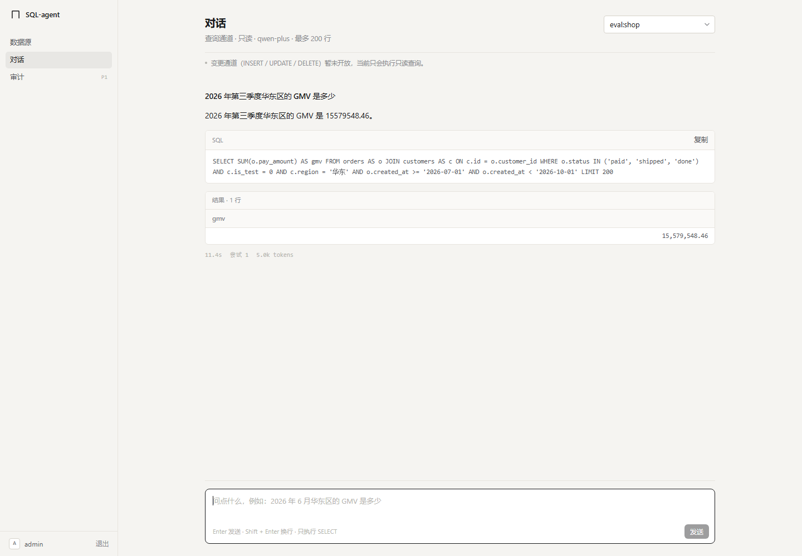
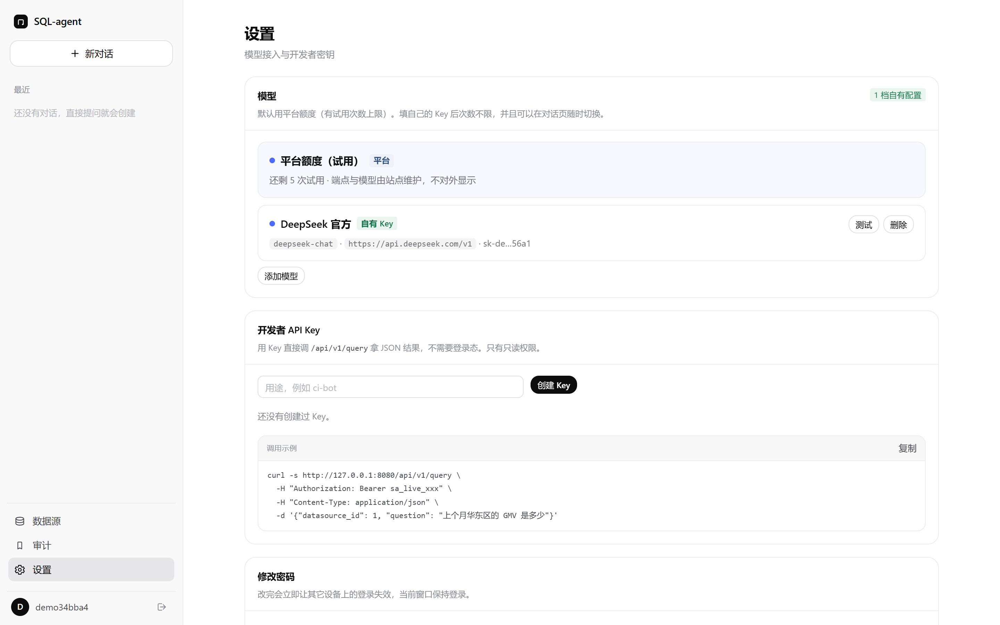
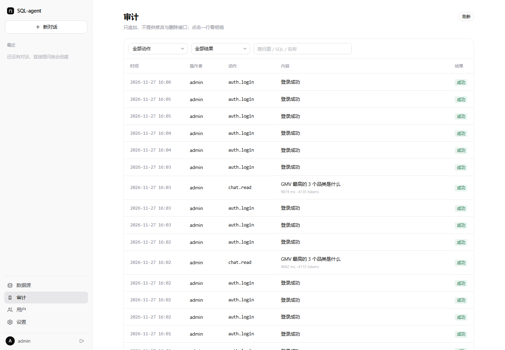
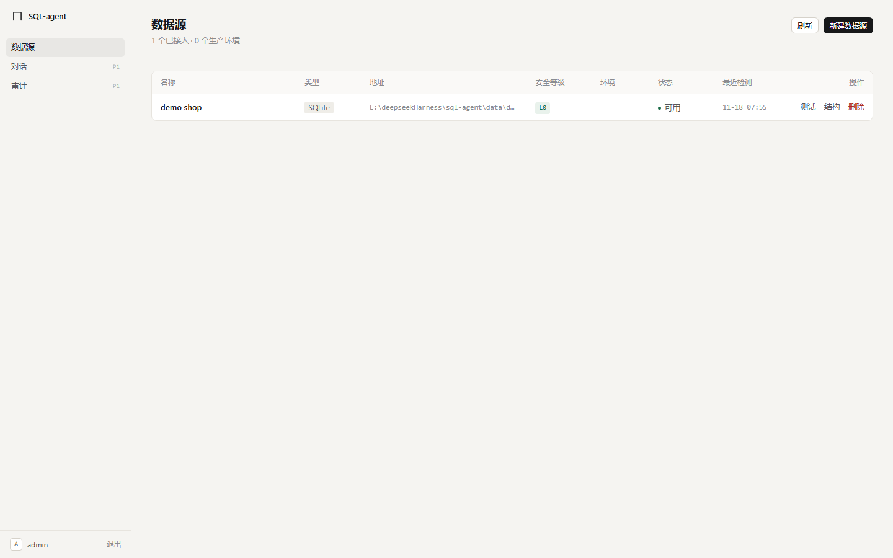

# SQL-agent

> 用中文提问，自动生成 SQL 并在**只读连接**上执行，把结论、SQL 和原始结果一起交给你。

[](../../actions)
[](LICENSE)

> 当前状态：**P0（地基）+ P1（只读问答）已完成**。变更通道（增删改）**本期不实现**，后端没有对应接口与执行路径，前端在对话页顶部有一行明确提示。下面写的「已完成」都是跑通并有测试覆盖的。

## 为什么再做一个 text-to-SQL

市面上两类产品各有缺口：

- **问数工具**（SQLBot / WrenAI 一类）：只读，安全，但口径靠提示词，换个库就失准。
- **通用 Agent 直连数据库**：灵活，但把「删库」和「查数」放在同一个按钮上，没人敢用在生产库。

SQL-agent 现在的选择是**先把只读做到可信**：只读连接 + AST 闸门 + 语义层 + 可评测。写操作（第二道门）在设计上留了位置，但这一期不写代码。

| | 只读通道 Query Plane（已实现） | 变更通道 Mutation Plane（本期不做） |
|---|---|---|
| 凭证 | 只读账号 | 独立的可写账号（数据模型里已预留字段，但没有使用方） |
| 连接 | `mode=ro` / 只读事务 | — |
| 能力 | SELECT，强制 LIMIT + 超时 | — |
| 流程 | 生成 → 闸门 → 执行 → 自纠错 | — |
| 默认 | 开 | 无入口 |

安全等级 `L0–L4` 的模型已经落在数据源配置里（高于 L0 必须填独立的可写凭证），但目前**没有任何代码会用到可写凭证**——它只是为将来的写通道预留的数据约束。

## 界面

<table>
  <tr>
    <td width="50%"></td>
    <td width="50%"></td>
  </tr>
  <tr>
    <td></td>
    <td></td>
  </tr>
</table>

前端不依赖 UI 框架：一套设计令牌 + 14 个自建组件（按钮 / 输入 / 选择 / 标签 / 弹窗 / 抽屉 / 轻提示）。
构建产物 `183 KB`（gzip `70 KB`）。没有渐变、没有阴影堆叠，数字与路径统一用等宽字体，颜色只留给语义状态。

## 已完成

**P0 · 地基**

- 登录 / JWT / scrypt 口令哈希
- 数据源管理：MySQL、PostgreSQL、SQLite 的增删查、连通性测试、结构快照
- **凭证不信封**：数据源口令用 Fernet 加密落库，接口永不回显；L2 及以上强制要求独立的可写账号
- 审计：登录、增删数据源、探测、取结构全部留痕（只追加）
- 单进程部署：后端自动托管 `frontend/dist`，SPA 路由回退已处理

**P1 · 只读问答**

- 上下文装配：BM25 选表 + 列注释 + 采样 + 业务语义层（指标口径 / 同义词 / 示例）
- 两段式生成：先出分析计划（选表、口径、时间范围），再写 SQL；信息不足时反问而不是瞎猜
- 只读闸门（sqlglot）：单语句、只允许 SELECT、表白名单、禁用函数、强制 `LIMIT`
- 执行器：10s 超时、行数上限、结果 JSON 化；SQLite 走 `mode=ro` 连接
- 自纠错：错误归类（未知列 / 未知表 / 歧义 / 超时）后回灌给模型，最多重写 3 次
- SSE 流式问答：`stage → sql → rows → answer → done`，前端按事件增量渲染
- 结论生成：基于真实结果写一句话，禁止模型自己心算
- 对话页顶部一行提示：变更通道未开放，当前只执行只读查询

**BYOK · 自带模型**

- 界面里填 Base URL / 模型名 / API Key，保存即生效，**不用改环境变量、不用重启**
- Key 用 Fernet 加密落库，接口只回显末四位；「测试连接」先打 `/models` 再退回一次 1-token 补全
- 未配置时对话页直接给出「去设置」的入口，不让人对着报错猜

**账号 · 登录与注册**

- 登录：JWT（scrypt 口令哈希），前端有独立登录页
- 注册：`POST /api/v1/auth/register`，**每个新用户自动新建一个工作空间**，与别人的数据源 / 模型 Key / 审计完全隔离
- `SQLAGENT_ALLOW_REGISTRATION=false` 可关闭注册（只保留初始化时创建的管理员）
- 缺什么：找回密码、改密码、邮箱验证、管理员后台——都还没有

**开发者接口**

- 设置页可创建 API Key（`sa_live_…`），明文只显示一次，库里只存 SHA-256
- `POST /api/v1/query` 用 Key 直接换 JSON：SQL、列、行、结论、耗时、token 一次返回
- Key 只有只读权限；吊销即时生效；每次调用进审计

**审计层**

- 独立事务写入：业务回滚了审计也留痕（登录失败也能查到）
- 每条记录自动带 `X-Request-ID`，响应头回传，前端截图能对上后端日志
- 控制台可按动作 / 结果 / 关键字筛选，点开看完整 detail（SQL、耗时、token、重试次数）
- 接口只有 GET：审计只追加，不提供修改与删除

**工程加固**

- `store.py` 收敛「数据源归属校验 + 凭证读取 + 会话外快照」，三处重复实现合并为一处
- Alembic 迁移：`python scripts/migrate.py`；老库自动 `stamp` 基线，随后 `--revision` 生成新版本
- 结构缓存换成有上限的 TTL 缓存（LRU + TTL），不再无限增长
- 取行数加了总预算（默认 2s）、采样改为并发，冷启动不再被大表拖住

**已验证**（不是"应该能跑"）：

| 项 | 结果 |
|---|---|
| 后端测试 | **105 passed**（闸门 26 项拒绝用例、执行器、问答循环、SSE、BYOK、SSRF 13 例、登录限流 7 例、缓存与语义层 9 例、API Key、注册与多租户隔离、审计隔离与失败留痕、凭证加密） |
| 端到端 | 登录 → 建源 → 测试 → 取结构：5 张表 / 20,000 订单 / 67 ms |
| **MySQL 全链路** | MySQL 8.1：连接 5ms → 5 张表 / 8,000 订单 / 16,133 明细 → 「2026 Q3 华东 GMV」= `12,628,663.50`（与手算**逐位一致**）→ 品类 Top3 三个数字全对 |
| 只读边界 | 用 `SELECT` only 的账号：查询正常；`INSERT` 被 MySQL 拒绝（`ERROR 1142`） |
| 真实问答 | 「2026 Q3 华东区 GMV」→ `15,579,548.46`，与手算一致，11.6s / 4.3k token |
| 开发者接口 | 用 `sa_live_…` 调 `/query`，12.1s 返回 `{sql, columns, rows, summary, tokens}` |
| 审计链路 | 一次问答自动落 `chat.read`，带 request_id / SQL / token / 耗时；失败与被限流的登录都留痕 |
| SSRF | `127.0.0.1 / localhost / 169.254.169.254 / 10.x / ::1 / 解析到内网的域名` 全部 400；公网端点正常保存 |
| 限流 | 同一用户名 5 次失败后第 6 次 429（带 `Retry-After`）；成功登录清零；关开关即恢复 |
| 迁移 | 空库 `upgrade` 建 6 张表；老库自动 stamp；`alembic check` 与模型零差异 |
| 评测 | 20 题演示集，`qwen-plus`，EX 见下方「评测」一节 |
| 前端构建 | `vue-tsc --noEmit` 0 error + `vite build` 成功，产物 gzip 71 KB |
| 未验证 | **PostgreSQL**（本机无实例，连握手都没跑过）、**Docker 镜像**（本机无 Docker，从未构建）、任意 schema 的准确率（见下） |

## 评测

```bash
cd backend && python ../evals/run_eval.py --save     # 20 题，结果写入 evals/results/
```

比的是**结果集**而不是 SQL 文本：列数、行数、行内容（数值容差 1e-6），排序与列别名不影响判定。

| 轮次 | EX | 说明 |
|---|---|---|
| 第一轮 | 75%（15/20） | 暴露 4 类问题：时间表达式编造（`strftime('%Y-Q%m')`）、fan-out 重复求和、过度反问、平均的平均 |
| 补语义约定 + 固定 seed | **95%（19/20）** | 8.8s/题，0.95 次尝试，约 4.3k token/题 |

唯一失败的是 q17「测试账号贡献的 GMV 是多少」：模型指出这个问题与 GMV 口径（必须排除测试账号）自相矛盾，于是反问而不是硬算。这是**我们希望的追问行为**，但评测按"没给出结果"记为失败——规则保持严格，不替模型找补。

**这个分数不能当泛化能力看。** 语义层是看着这 20 题的失败样本补出来的（时间区间、fan-out、平均口径三类约定），属于对单库演示集的过拟合。它说明的是「链路是通的、失败模式可定位可修」，不代表换库也这么准。真实泛化要等 P3 用 BIRD/Spider 子集做跨库评测。

一个具体的过拟合证据：修语义层之前，同一道「品类 GMV」3 次里错 2 次（`SUM(pay_amount)` 被明细行重复累加，算出 2.21 亿而真值 1.33 亿）；把「品类 GMV」定义成一等指标并写进 `metrics` 后，3/3 稳定正确。**改配置比改 prompt 有效**，这也是语义层存在的理由。

同类还有一个更隐蔽的坑：「退款金额占 GMV 的比例」——退款只发生在 `cancelled/refunded` 订单上，而 GMV 只统计 `paid/shipped/done`，模型天真地用 `JOIN refunds` 把两边连起来，结果互相过滤成空集，回答"没有数据"。把 `refund_rate` 写成「分子分母各用子查询、不要 join」之后，稳定给出 6.36%（真值 0.0636）。

评测集故意包含**语义陷阱**：测试账号占 5%、取消/退款单占 8%。直接用 `SUM(pay_amount)` 算 GMV 会比正确口径高约 16%，能被自动判错。

## 快速开始

### Docker 一条命令

```bash
cp .env.example .env          # 只有 SECRET_KEY 和管理员口令是必须改的
docker compose -f deploy/docker-compose.yaml up -d --build
```

打开 `http://127.0.0.1:8080`，用 `admin` / `.env` 里设的口令登录。**不需要在环境变量里配模型**：

1. 进「设置」→ 填 Base URL（默认通义千问兼容端点）、模型名、API Key → 点「测试连接」→ 保存
2. 进「数据源」→ 新建 → 选 MySQL / PostgreSQL / SQLite，填**只读账号**
3. 进「对话」→ 直接提问

部署到公网服务器时看这两份：

- [deploy/README.md](deploy/README.md)：通用部署、HTTPS、备份、安全清单
- [deploy/aliyun/README.md](deploy/aliyun/README.md)：**阿里云 ECS 一步步来**（安全组、镜像加速、备案、Nginx + SSE、运维脚本）

### 本地开发

```bash
# 后端
cd backend
python -m venv .venv && source .venv/bin/activate   # Windows: .venv\Scripts\activate
pip install -e ".[dev]"
uvicorn app.main:app --reload --port 8080           # http://127.0.0.1:8080/docs

# 前端（另开一个终端）
cd frontend && pnpm install && pnpm dev              # http://127.0.0.1:5173
```

跑测试：`cd backend && pytest -q`

### 造一个演示库（可选）

```bash
python scripts/seed_demo.py            # 生成 data/demo/shop.db：2 万笔订单的中文电商库

# 或者：MySQL 版（会 DROP 并重建 sqlagent_demo 库，只动这个名字）
python scripts/seed_mysql_demo.py --user root --password 你的密码
```

这个库里**故意埋了坑**：5% 的客户是测试账号、8% 的订单已取消/退款、退款单独一张表。
直接用 `SUM(pay_amount)` 算出来的 GMV 会比正确口径高约 16% —— 正好用来验证语义层有没有生效。
在「数据源」页新建一个 SQLite 数据源，路径填 `data/demo/shop.db` 即可。

MySQL 版会顺便建一个**只有 SELECT 权限**的账号 `sqlagent_ro`，并打印标准答案
（GMV / 品类 Top3），可以直接拿去和 SQL-agent 的回答对比。

## 面向开发者

在「设置 → 开发者 API Key」创建 Key（`sa_live_…`，只显示一次），然后：

```bash
curl -s http://127.0.0.1:8080/api/v1/query \
  -H "Authorization: Bearer sa_live_xxx" \
  -H "Content-Type: application/json" \
  -d '{"datasource_id": 1, "question": "2026 年第三季度华东区的 GMV 是多少"}'
```

```json
{
  "question": "2026 年第三季度华东区的 GMV 是多少",
  "sql": "SELECT SUM(o.pay_amount) AS gmv FROM orders o JOIN customers c ON c.id = o.customer_id WHERE ...",
  "columns": ["gmv"],
  "rows": [[15579548.46]],
  "summary": "2026 年第三季度华东区的 GMV 是 15579548.46。",
  "explain": "按季度与大区聚合成交额",
  "tables": ["customers", "orders"],
  "attempts": 1,
  "truncated": false,
  "elapsed_ms": 11783,
  "tokens": 5042,
  "model": "qwen-plus",
  "error": null,
  "clarification": null
}
```

几条约定：

- Key **只有只读权限**：拿不到数据源管理、改不了配置，写操作本来就不存在
- 拿不到结果时看 `error`；需要用户补充信息时看 `clarification`（此时 `sql` 为 null）
- 调用会进审计（动作 `api.query`，记录来源、SQL、耗时、token）
- 吊销即时生效：删掉 Key 后同一秒的请求就会 401

### 配置语义层（决定准不准的关键）

```bash
cp docs/semantics.example.yaml backend/data/semantics.yaml
# 或者用环境变量指到任意位置：SQLAGENT_SEMANTICS_PATH=/etc/sql-agent/semantics.yaml
```

三个部分，缺一不可：

| 段 | 作用 | 例子 |
|---|---|---|
| `metrics` | 指标口径：算式 + 必须附加的过滤条件 | `gmv = SUM(o.pay_amount)`，且 `status IN ('paid','shipped','done')`、`is_test = 0` |
| `synonyms` | 中文术语映射到具体条件 | 「华东」→ `c.region = '华东'` |
| `examples` | 同库的真实问答对（few-shot） | 「2026 Q3 华东 GMV」→ 带正确日期区间的 SQL |

`notes` 用来写「这个库的坑」：时间字段是文本、按品类统计要防 fan-out、平均每单件数别用 `AVG`。
**这张表就是你的业务 Know-how**，也是为什么同样的模型换个库就不好使。

### 换模型

任意 OpenAI 兼容端点都能用（通义千问 / DeepSeek / vLLM / Ollama）：

```bash
SQLAGENT_LLM_BASE_URL=https://dashscope.aliyuncs.com/compatible-mode/v1
SQLAGENT_LLM_MODEL=qwen-plus
SQLAGENT_LLM_API_KEY=sk-...
```

## 想读懂它怎么实现的

[docs/TUTORIAL.md](docs/TUTORIAL.md) 是写给 **agent 初学者**的教程：从「一次提问在代码里走了哪几步」开始，
逐层拆开上下文装配、两段式生成、只读闸门、执行器、自纠错、SSE，最后是 6 个可动手的实验
（其中 3 个不花钱：看上下文、抓 SSE、让闸门拒一条 SQL）+ 改造练习和学习路线。

配套的两个教学脚本：

```bash
python scripts/inspect_context.py --sqlite data/demo/shop.db --question "2026 年第三季度华东区的 GMV 是多少"
python scripts/guard_demo.py
```

## 架构

```
Vue 3 控制台 ──HTTPS/SSE──► FastAPI
                             ├── auth / datasource / audit           （P0）
                             ├── engine：上下文装配 → 生成 → 闸门 → 执行 → 自纠错（P1）
                             └── mutation：预览 → 确认 → 执行 → 回执/回滚（P2）
                             │
                    PostgreSQL（元数据）· Redis（缓存/限流，P3 引入）
                             │
                     目标库：只读凭证 / 读写凭证（物理隔离）
```

目录：

```
backend/app/
├── api/          HTTP 路由（auth / datasources / chat / health）
├── engine/       问答引擎
│   ├── context.py    BM25 选表 + 结构渲染 + 采样
│   ├── semantics.py  指标口径 / 同义词 / 示例
│   ├── generate.py   两段式生成（计划 → SQL）+ 结论
│   ├── guard.py      只读闸门（sqlglot AST 白名单 + 强制 LIMIT）
│   ├── execute.py    只读执行（超时 / 行数上限 / 结果规范化）
│   ├── llm.py        OpenAI 兼容客户端 + JSON 解析 + 测试替身
│   └── pipeline.py   主循环与自纠错
├── dialects.py   方言适配：DSN、超时、版本、行数估算
├── introspect.py 结构快照
├── security.py   口令哈希、JWT、凭证加密
├── audit.py      只追加审计
└── main.py       入口；若存在 frontend/dist 则同时托管前端
evals/            golden.jsonl（20 题）+ run_eval.py
frontend/         Vue 3 + TS + Vite 控制台
deploy/           Dockerfile 与 compose
```

## 接口

| 方法 | 路径 | 说明 |
|---|---|---|
| GET | `/api/v1/health` | 健康检查（免鉴权） |
| GET | `/api/v1/auth/config` | 是否开放注册（免鉴权） |
| POST | `/api/v1/auth/register` | 注册（自动创建独立工作空间） |
| POST | `/api/v1/auth/login` | 登录取 token |
| GET | `/api/v1/auth/me` | 当前用户 |
| GET/PUT | `/api/v1/settings/llm` | 读 / 写模型配置（BYOK），Key 只回显末四位 |
| POST | `/api/v1/settings/llm/test` | 测试模型连通性 |
| GET/POST | `/api/v1/keys` | 开发者 API Key 列表 / 创建（明文只返回一次） |
| DELETE | `/api/v1/keys/{id}` | 吊销 Key |
| POST | `/api/v1/query` | **开发者查询**：Key 换 JSON（SQL + 结果 + 结论） |
| GET/POST | `/api/v1/datasources` | 列表 / 新建（Key 也可读） |
| DELETE | `/api/v1/datasources/{id}` | 删除 |
| POST | `/api/v1/datasources/{id}/test` | 连通性测试 |
| GET | `/api/v1/datasources/{id}/schema` | 表结构快照 |
| GET | `/api/v1/chat/config` | 当前模型与限额 |
| POST | `/api/v1/chat/stream` | **SSE 问答**：`stage / sql / rows / answer / clarify / error / done` |
| POST | `/api/v1/chat/feedback` | 人工纠错，先落审计（P3 接入示例库检索） |
| GET | `/api/v1/audit` | 审计列表：`action` / `result` / `actor` / `q` + 分页 |
| GET | `/api/v1/audit/actions` | 出现过的动作类型（填筛选下拉框） |
| GET | `/api/v1/audit/summary` | 近 N 天按动作 × 结果的计数 |

所有响应都带 `X-Request-ID` 头；也可以自己传一个，日志与审计会沿用。

## Roadmap

| 阶段 | 内容 | 状态 |
|---|---|---|
| P0 | 账号、数据源、结构快照、审计、部署骨架 | ✅ |
| P1 | 上下文装配、语义层、两段式生成、只读闸门、自纠错、SSE 对话、20 题评测 | ✅ |
| P1.5 | 审计层（独立事务 + request id + 控制台）、Alembic 迁移、归属校验收敛、缓存上界 | ✅ |
| P2 | 变更通道：dry-run 预览、diff 确认、执行、回执、反向 SQL、30 题写评测 | ⏸ 本期不做 |
| P3 | RBAC、L3 审批、注册限流、审计归档、JWT 改 cookie | ⏳ |
| P4 | 文档站、多架构镜像、release 流程、英文 README | ⏳ |
| P5 | iframe 嵌入、OpenAPI 描述、MCP server、图表 | ⏳ |

P2 不是"还没做"，是**这一期明确不做**：没有 `/mutation` 路由、没有写执行器，数据源上「可写凭证」字段目前只是数据约束，不会被任何代码使用。后端唯一相关的是一个未被调用的辅助函数 `count_rows()`，用来在将来估算影响面。前端在对话页顶部有一行提示，避免用户误以为可以改数据。

明确不做：DDL 自动执行、跨库联邦查询、ETL、BI 大屏。

## 安全声明

本项目**只读**：所有查询都走只读连接（SQLite `mode=ro`，MySQL/PG 请使用只有 SELECT 权限的账号），闸门只放行单条 SELECT 并强制 `LIMIT`。

三条已经内置的防线，值得单独说明：

| 面 | 做法 | 开关 |
|---|---|---|
| **BYOK 的 SSRF** | 保存/测试 `base_url` 时解析域名，拒绝一切非公网地址（`127.0.0.1`、`169.254.169.254` 云元数据、`10/8` 等），含 IPv4-mapped IPv6 | `SQLAGENT_LLM_ALLOW_PRIVATE_HOSTS=true` 放行（本地跑 Ollama/vLLM 时） |
| **登录爆破** | 同一 IP 与同一用户名各一个滑动窗口，超限返回 429（带 `Retry-After`），并记一条 `rate_limited` 审计。**硬锁定**：超限后正确密码也拒绝——否则限流形同虚设；代价是知道用户名的人可以把你锁 5 分钟 | `SQLAGENT_LOGIN_RATELIMIT_ENABLED=false` 关闭 |
| **越权读** | 所有数据源查询按 `workspace_id` 过滤，「不存在」与「无权」统一返回 404，避免用状态码探测 id | — |

仍然建议：不要用生产主库的超级账号接入、保留备份、把它当成一个"能读全库的助手"来评估权限风险。因配置不当（例如误用了高权限账号）造成的数据泄露由使用者承担。

还**没有**做的：JWT 存 localStorage（XSS 可窃取）、注册频率限制、审计日志自动归档。这几项在 Roadmap 的 P3。

## 贡献

见 [CONTRIBUTING.md](CONTRIBUTING.md)（P1 阶段补齐）。提 issue 前请说明数据库类型、方言版本与复现步骤。

## 许可证

[Apache-2.0](LICENSE)。本项目在功能上参考了同领域开源产品（如 DataEase SQLBot），但**代码为独立实现**：其许可证为修改版 GPLv3 且带品牌条款，不可直接复用代码。